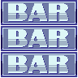
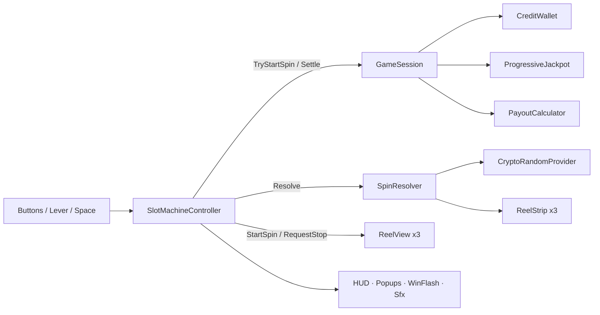

<h1 align="center">🎰 Slot Machine — Unity</h1>

<p align="center">
  A classic 3-reel slot machine built in Unity for the Underpin Technology game development assignment.<br/>
  Smooth reel physics, a fair crypto-grade RNG, a tested payout engine, and two bonus features.
</p>

<p align="center">
  
  
  
  
</p>

---

<!-- DEMO_SECTION -->

## 🎮 Game overview

Pull the lever (or press **SPIN** / **Space**). Three reels spin and stop one after another.
**You win when all three reels land the same symbol on the red centre line.**

| Symbol | 3 of a kind pays | Extra | Weight on each reel |
|:---:|:---:|:---|:---:|
|  **Seven** | **50 ×** bet | + the whole **progressive jackpot** | 2 / 20 |
|  **BAR** | **25 ×** bet | | 4 / 20 |
|  **Bell** | **10 ×** bet | + **5 free spins** | 6 / 20 |
|  **Cherry** | **4 ×** bet | | 8 / 20 |

- Start with **1,000 credits**; bets are **10 / 50 / 100** (the options from the design reference).
- Run out of credits and a **YES / NO** dialog offers a free refill (it's a demo, no real money).
- The **PAYTABLE** button shows all of this in-game, built from the same data the game pays from.

### Requirements checklist

| Requirement | How it's done |
|---|---|
| ✅ Winning logic | `PayoutCalculator`: win only when every reel shows the same symbol. |
| ✅ Smooth reel animations | `ReelView`: wind-up, acceleration, full-speed spin with motion blur, eased stop, overshoot and settle bounce, staggered stops. |
| ✅ Clean symbol display | Reels sit exactly inside the cabinet windows (pixel coordinates measured from the provided art), point-filtered pixel art, masked viewports. |
| ✅ Randomised outcomes (RNG) | `CryptoRandomProvider`: OS cryptographic RNG with rejection sampling (no modulo bias). |
| ✅ Winning combinations & payouts | Data-driven `SymbolDefinition` / `PaytableDefinition` ScriptableObjects + `GameSession` credit flow, unit tested. |
| ⭐ Bonus features | Progressive jackpot, free spins with auto-play, near-miss anticipation, QA "force outcome" tool, sound effects. |

---

## ⭐ Bonus features

1. **Progressive jackpot**: 5% of every paid bet goes into a pot shown on screen. Three Sevens pay 50× **plus the whole pot**, which then resets to 1,000.
2. **Free spins**: three Bells award 5 free spins. They play automatically at the bet that triggered them (the bet is locked), and landing Bells again adds 5 more.
3. **Near-miss anticipation**: when the first two reels already match, the last reel keeps spinning a little longer ("So close...!"), like classic machines.
4. **QA tool**: the small **QA** button (bottom-left) forces the *next* spin to land three of a chosen symbol, so the jackpot and free spins can be checked without hundreds of spins. Normal spins are never affected.
5. **Game feel**: lever pull, win flash over the reels, symbol pulse on wins, pop-in popups, counting-up win amount, and sound effects (lever ratchet, reel loop, reel-stop thunk, coin ticks, win fanfares) made for this project.

---

## 🧠 Thought process / approach

**1. Decide first, animate second.**
The result of a spin is picked by the RNG *before* any reel moves (`SpinResolver.Resolve()`). The reels then animate to those exact stop positions. The animation can never change the outcome, which is how real machines work and keeps the logic testable.

**2. Fair, explainable odds.**
Each reel has a strip of 20 stops; a symbol appears on the strip as many times as its weight (Seven ×2 … Cherry ×8). Every stop is equally likely, so P(symbol) = weight / 20 and P(three Sevens) = (2/20)³ = 0.1%.
The RNG is `System.Security.Cryptography.RandomNumberGenerator` (unpredictable, unlike `UnityEngine.Random`). To avoid **modulo bias**, draws from the uneven tail of the 32-bit range are rejected. If a platform has no crypto RNG, it falls back to a well-seeded `System.Random` so the game still runs.

**3. Balanced on paper, then checked by simulation.**

| | Value |
|---|---|
| Base game return | 0.1%·50 + 0.8%·25 + 2.7%·10 + 6.4%·4 = **77.6%** |
| Free spins (bell triggers) | ≈ **12.1%** |
| Jackpot contributions paid back | ≈ **5%** |
| **Target RTP** | **≈ 94.7%**, hit rate 1 in 10 spins |

`Underpin > Simulate RTP (1M spins)` plays a million spins through the real `GameSession` to confirm it.

**4. Reel animation that feels physical.**
A reel is one float (`position`, in symbols) and 5 recycled `Image` cells inside a `RectMask2D`, so it's endless with no allocations. A spin runs in phases:

```
wind-up (pull back 0.3) → accelerate → full speed (+ motion-blur stretch)
→ keep spinning until exactly N symbols before the target
→ ease-out brake (duration chosen so starting speed == full speed: no jerk)
→ overshoot → smoothstep settle onto the payline
```

Every reel brakes over the same distance, so each stop looks the same wherever the target is on the strip.

**5. Clean separation.**
Rules are plain C# classes, no MonoBehaviour (`GameSession`, `PayoutCalculator`, `ReelStrip`, `CreditWallet`, `ProgressiveJackpot`), so they're unit tested in milliseconds. MonoBehaviours only display and animate. `SlotMachineController` just runs the spin sequence in the right order.

**6. A reproducible scene.**
`Underpin > Rebuild Slot Machine Scene` (`SlotSceneBuilder`) creates the scene, prefabs, data assets and animation clips from code, using the measured cabinet coordinates. Every reference is wired the same way each time.

---

## 🏗️ Architecture



## 📁 Project structure

```
Assets/
├── Scripts/
│   ├── Data/        SymbolDefinition, PaytableDefinition (ScriptableObjects)
│   ├── RNG/         IRandomProvider, CryptoRandomProvider, SeededRandomProvider
│   ├── Logic/       ReelStrip, SpinResolver, PayoutCalculator, GameSession, CreditWallet, ProgressiveJackpot
│   ├── Reels/       ReelView, ReelAnimationProfile
│   ├── Machine/     SlotMachineController, LeverView, WinFlashView
│   ├── UI/          HudView, PopupView, WinPopupView, PaytableView, ConfirmDialogView, QaPanelView, UiAnimations
│   └── Audio/       SfxPlayer
├── Editor/          SlotSceneBuilder, SpriteImportProcessor, WebGLBuilder, RtpSimulator
├── Tests/EditMode/  Payout, session, RNG and reel-strip tests
├── Prefabs/         Reel, WinPopup, PaytablePopup, ConfirmDialog (generated)
├── Animations/      ReelAnimationProfile, WinTitleGlow, SpinButtonIdle (generated)
├── UI/Sprites/      Provided art (machine, symbols, buttons, panels)
├── Sounds/          Sound effects
├── Data/            Symbol + paytable assets (generated)
└── Scenes/          SlotMachine.unity (generated)
Build/WebGL/         Playable WebGL build
```

---

## ▶️ How to run

### Play the WebGL build

Browsers block Unity WebGL from `file://`, so serve the folder locally:

```bash
git clone https://github.com/amartya1523/unity-slot-machine.git
cd unity-slot-machine/Build/WebGL
python3 -m http.server 8000
```

Then open <http://localhost:8000>.

### Open the project

1. Unity **2022.3 LTS** (any 2022.3.x) with **WebGL Build Support**.
2. Add the repo folder in Unity Hub and open it. If `Assets/Scenes/SlotMachine.unity` isn't there yet, run `Underpin > Rebuild Slot Machine Scene`.
3. Open the scene and press **Play**.

### Build WebGL yourself

`Underpin > Build WebGL`, or:

```bash
Unity -batchmode -quit -projectPath . -executeMethod Underpin.SlotMachine.EditorTools.WebGLBuilder.BuildFromCommandLine
```

### Run the tests

`Window > General > Test Runner > EditMode > Run All` (payouts, free spins, jackpot, bet locking, RNG bounds and uniformity, reel strip weights).

---

## 🌿 Git workflow

Work happened on feature branches merged into `main` with merge commits, so the history shows how the project grew:

- `feature/core-logic`: data, RNG, payout rules, session, tests
- `feature/reels-and-ui`: reel animation, machine, UI, scene builder
- `feature/webgl-build`: build tooling, RTP simulator, WebGL build

---

## 🎨 Credits

Art: provided by Underpin Technology with the assignment. Code, sound effects and balancing: Amartya Vikram Singh.
